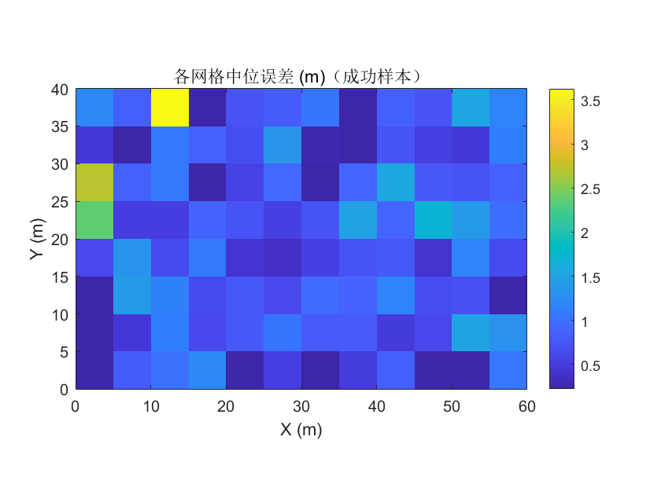
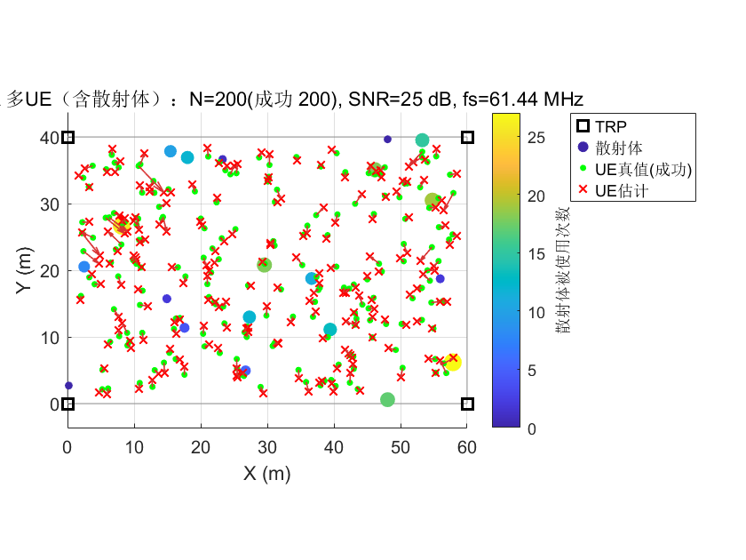
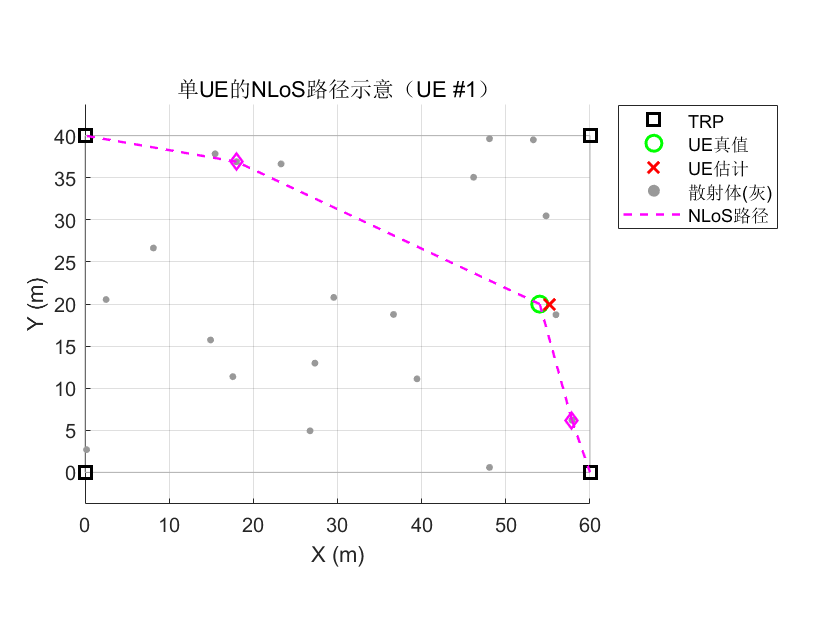
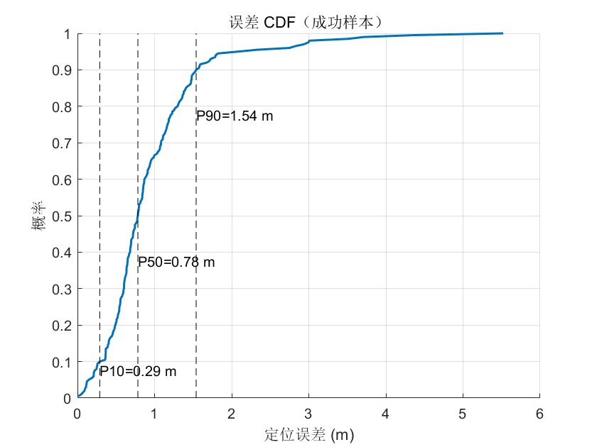
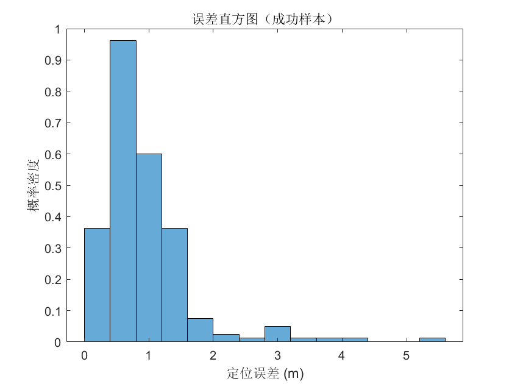

# [TDOA+ISAC]Research on Wireless Positioning Simulation Theory Based on TDoA and LM Algorithm[with MATLAB Code]

1 Introduction Wireless positioning technology has widespread applications in communication, navigation, and the Internet of Things (IoT). Time Difference of Arrival (TDOA) is one of the core positioning methods. It estimates the target's location by measuring the time difference between the arrival times of the target signal at multiple base stations (Transmission and Reception Points, TRPs), balancing the advantages of high positioning accuracy with system complexity. This paper addresses the TDoA positioning problem in complex wireless environments, integrating both Line of Sight (LoS) and Non-Line of Sight (NLOS) propagation scenarios. A complete simulation system is constructed that includes scattering body modeling, high-precision TOA estimation, and robust position solution calculation. The theoretical foundation and technical implementation are systematically explained around the functional modules of the core code.
2 Core Theoretical Foundations 2.1 TDoA Positioning Fundamentals
The line-of-sight distance from the target to the base station satisfies, where is the speed of light and is the TOA (Time of Arrival) of the signal reaching the first base station. Define the time difference, then the corresponding distance difference is, and thus establish a nonlinear positioning equation group:
When the number of base stations is known, the solution to this equation set uniquely determines the target position.
2.2 Wireless Propagation Model (LoS/NLoS and Scattering Body Modeling) 2.2.1 LoS/NLoS Link Characteristics In wireless channels, there are two modes of signal propagation: LoS and NLoS.
•  
LoS Link: The signal is transmitted directly from the target to the base station without obstruction interference, with a propagation distance of direct line-of-sight distance, and amplitude attenuation follows the path loss model.
•  
NLOS Link: The signal reaches the base station after being reflected by an environmental scattering body, adopting a single scattering model, with propagation distances (for each scattering body's coordinates). Additionally, an additional reflection attenuation coefficient is introduced to correct amplitude losses.
The probability of link LoS is controlled by parameters, and random simulation of LoS/NLoS links is realized through random number generation. Moreover, the reference base station is forced to be a LoS link to ensure the stability of positioning benchmarks.
2.2.2 Scatterer Modeling Environment: The scatterers are modeled using a random distribution, generating them within the specified area. The coordinates are generated through a uniform random function. For NLoS links, the scattering point that minimizes propagation distance is selected as the signal reflection point to ensure compliance with the physical law of minimal energy loss during actual propagation.
2.3 High Precision TOA Estimation Method
•  
ZC Sequence Characteristics: The ZC sequence is a constant amplitude zero auto-correlation (CAZAC) sequence, expressed as ( ), which has good auto-correlation and anti-interference capability, suitable for signal detection sequences.
•  
Matching filter: By calculating the cross-correlation function between the received signal and the local ZC sequence, the preliminary estimation of the arrival time of the signal is made by using the peak position of the correlation.
•  
Tri-point Interpolation: To address the integer delay estimation error caused by discrete sampling, a tri-point quadratic interpolation is adopted. The fractional delay offset is calculated by the correlation values of three points near the peak, achieving high-precision TOA estimation at sub-sampling levels.
2.4 Levenberg-Marquardt (LM) Robust Optimization Algorithm TDoA The positioning equation set is nonlinear, and the LM algorithm is used to solve the non-linear least squares problem. It balances the convergence speed of the Gauss-Newton method with the stability of the gradient descent method. Its core idea is to introduce a damping factor to adjust the iteration direction:
1  
Objective function: Define the weighted residual sum of squares as, where is the weight based on the peak amplitude of the received signal, and is the number of base stations participating in positioning.
2  
Iterative Update: Constructing the Jacobian matrix and Hessian matrix (approximated by a weight diagonal matrix) with an iterative step size of;
3  
Damping factor adaptive adjustment: If the residual decreases, reduce (enhance Gaussian-Newton characteristics), if the residual increases, increase (enhance gradient descent characteristics), to ensure convergence of iterations.
Furthermore, by setting parameters such as the maximum number of iterations, convergence threshold, and step size restrictions, the algorithm's robustness is further enhanced.
3. Simulation System Design
•  
Basic physics parameters: speed of light, sampling rate (determines the resolution of TOA estimation);
•  
Scenario parameters: Location dimensions, base station coordinates, target user count, number of scatterers;
•  
Channel parameters: Received Signal-to-Noise Ratio, LoS Probability, NLoS Reflected Decay;
•  
Algorithm parameters: Initial value of damping factor for the LM algorithm, increase/decrease coefficient, and weight limit.
Ensure the reproducibility of simulation results by fixing a random seed.
3.2 Signal Generation and Receive Process 1
Transmit signal construction: ZC sequence with zeros (...) before and after to avoid convolution out of bounds, forming the transmit signal.
2  
Signal reception and generation: Based on the LoS/NLoS link type, calculate the propagation delay and amplitude attenuation of the signal. Implement fractional time delay by linear interpolation. Add complex Gaussian white noise that meets the required signal-to-noise ratio.
3  
Signal preprocessing: Matched filtering and three-point interpolation are applied to the received signal, outputting high-precision TOA estimation values.
3.3 Positioning and Determination Process 1
Base Station Filtering: Supports two base station selection modes, namely all base stations participating or only LoS base stations participating (requires at least 3 LoS base stations + reference base stations), automatically switches to the all base stations mode when there are insufficient LoS base stations.
2  
Measurement gate control: Calculate the reasonable range of distance difference based on the geometric features of the site, eliminate abnormal measurement values that exceed the boundary to avoid invalid calculations.
3  
Initial Value Setting: Use the mean coordinate of the participating positioning base stations as the initial iteration value for the LM algorithm to enhance convergence speed.
4  
Position Solution and Verification: Iteratively solve the target position through the LM algorithm, judge the convergence of iterations and the validity of the solution, and output the final estimated position.
4 Performance Evaluation Method
•  
Calculation Success Rate: The ratio of the number of effective positioning to the total number of users (effective positioning means that the calculation converges and the position is within a reasonable range);
•  
Error Metrics: Mean, Median, 10th percentile (P10), 90th percentile (P90), and maximum of the Euclidean distance between true values and estimated values for positioning errors.
•  
Algorithm Efficiency: The average number of iterations for the LM algorithm is directly proportional to the average number of base stations involved in positioning.
4.2 Visualization analysis is used to intuitively present the positioning performance and system characteristics, design multi-dimensional visualization schemes:
•  
Geometric distribution plot: Shows the spatial distribution of base station, scatterers, target true values and estimated values, as well as the positioning error vector.
•  
NLOS Path Diagram: Individually present the NLoS propagation path (Target - Scatterer - Base Station) of a single target, verifying the rationality of the scattering body model.
•  
Error CDF Curve: Reflects the cumulative distribution characteristic of positioning errors, used to evaluate the coverage probability at different error levels;
•  
Error histogram: Displays the probability density distribution of positioning errors, reflecting the central tendency of the error;
•
Regional error heatmap: Divides the field into grids, using the median positioning error within each grid as an indicator to present the regional differences in positioning accuracy.
5 Conclusion This paper builds a wireless positioning simulation system based on TDoA (Time Difference of Arrival) positioning technology, integrating complex wireless propagation models, high-precision TOA (Time Of Arrival) estimation, and robust optimization algorithms. The core theories include TDoA positioning equations, single-scattering propagation models for LoS/NLoS, ZC sequence matching filtering with three-point interpolation for TOA estimation methods, and the nonlinear least squares solution scheme of LM (Least Mean Squares) algorithm. Through flexible parameter configuration, rigorous calculation processes, and multidimensional performance evaluation, comprehensive simulation and analysis of positioning performance under different wireless environments have been achieved, providing theoretical support and simulation tools for the design and optimization of actual TDoA positioning systems.

## Images

<!-- PAYMENT_BLOCK -->

## Get this dataset

- Payment link (Stripe): [Buy now](https://buy.stripe.com/3cs8yP7sY87d0vu9AB)
- Payment QR code: 

<!-- /PAYMENT_BLOCK -->
